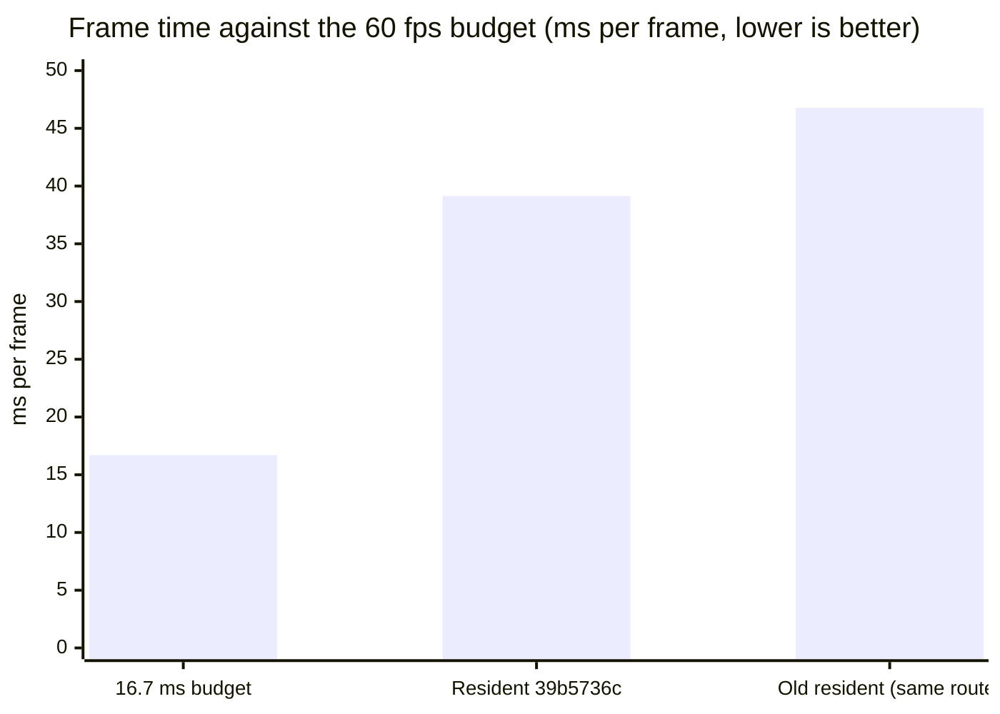
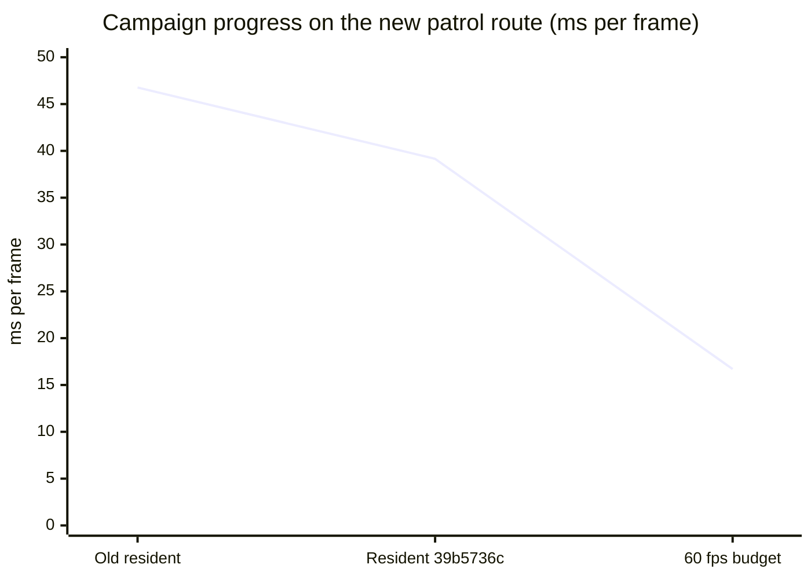

# no100f-nx: Scooby-Doo! Night of 100 Frights for Nintendo Switch

An unofficial Switch port of Scooby-Doo! Night of 100 Frights (GameCube, 2002), built with WiiCompiled and Aurora static recompilation. It is not an emulator. The game's own code, from the USA GameCube disc, is translated ahead of time into native code and built as a homebrew program (a `.nro`) for a modded Switch running Atmosphère.

## Legal notice

This is an unofficial fan project. It is not affiliated with or endorsed by Nintendo, Warner Bros., or the game's publishers or developers. Scooby-Doo! Night of 100 Frights and all game IP belong to their respective owners.

**No game data is included or distributed.** Not in this repository, and not in any release download. You must supply your own legally obtained copy of the game: GameCube USA, GIHE78, revision 1. Without those files the download does nothing. The licence in this repository (GPLv3) covers the code only.

## Status in short

- It boots and plays on real hardware. The front end, the title, the menu, loading a save, and gameplay in Mystic Manor all work. The load completes unaided on the current resident build, and a full 12-leg patrol route runs end to end.
- It runs below 60 frames per second in heavy 3D at stock clocks. That is measured, not guessed, and the work to close the gap is in progress. See "Performance" before quoting any number about this port.
- Pacing is correct: the built-in fps60 mechanism doubles the retrace count only for the main-loop poll, and the engine times itself by the measured clock, so the game keeps its correct speed. The whole problem is frame cost, not pacing.
- This port has not been played from start to finish on this build, so later areas should be expected to have bugs. See "Known issues".

| Item | State |
|---|---|
| Boots and plays on real hardware | Yes, current resident build `39b5736c` |
| Title, menu, save load | Working, load completes unaided |
| Full patrol route in Mystic Manor | Runs end to end (12 legs) |
| Heavy 3D at stock clocks | Below 60 fps, measured (see Performance) |
| Played start to finish | No, later areas are little tested |
| Release on this repository | [PENDING: no release has been cut from this fork yet] |

## Installing (first install)

You need a modded Switch running Atmosphère, and your own legally obtained copy of the game (GameCube USA, GIHE78, revision 1).

1. Download the Switch release from this repository's releases page. [PENDING: exact release zip name and layout are not yet confirmed for this fork. The staging layout the build produces is `switch/no100f-nx/` holding `no100f-nx.nro`, `dsp_coef.bin`, `cacert.pem`, `initial_pipeline_cache.db`, a `wii_bootstrap/` folder, and a `licenses/` folder.]
2. Copy the release folder onto the SD card, merging with what is already there. Never replace the whole `switch/no100f-nx/` folder: its `UserData` holds your saves and logs.
3. Put your game files in `sdmc:/switch/no100f-nx/game/` (the extracted disc's `DATA` folder contents, with `files/` and `sys/` inside). The port does nothing without them.
4. Launch with title takeover: hold R while starting any installed game, then pick no100f-nx in the homebrew menu. [PENDING: confirm the launch path for the release. The build script says title takeover; whether a forwarder tile is also shipped is not yet confirmed.]

Saves live in `sdmc:/switch/no100f-nx/UserData/` as GameCube memory-card saves. Copy that folder somewhere safe to back them up.

## Updating

**Never delete or wipe the `switch/no100f-nx/` folder to update.** Everything you care about lives in it, and an update is only ever a new `.nro`.

1. Take the `no100f-nx.nro` from the new release.
2. Copy it into `switch/no100f-nx/` on the card, replacing the old `.nro`.
3. Leave everything else in place: your `Config.toml`, your saves, your logs, your caches, and anything else already in that folder all carry over untouched.

To go back to an older build, put its `.nro` back the same way. Nothing else needs to change unless the release notes say so.

## Controls and settings

### Controls

The in-game buttons are the GameCube layout as the port maps it to the Switch controller. [PENDING: the exact in-game control mapping has not been verified against the tree yet. The table below lists only what hardware runs have proven.]

| Input | What it does | How it is known |
|---|---|---|
| PLUS (hold, in a movie) | Exits the movie to the title screen | Proven on hardware, flight 8 |
| PLUS (hold, on the title screen) | Opens the main menu | Proven on hardware, flight 8 |
| Left stick up/down in the menu | Moves the menu selection | Proven on hardware: stick -Y moves the selection |
| B in the menu | Choose (the on-screen prompt reads "B CHOOSE") | Proven on hardware, flight 8 |
| D-pad DOWN in the menu | Does not move the selection | Proven on hardware: the guest sees the press and nothing moves |

The main menu offers NEW GAME, LOAD GAME, OPTIONS, THEATRICAL TRAILER, and CREDITS.

### Settings

Settings live in `Config.toml` in `sdmc:/switch/no100f-nx/UserData/`. [PENDING: the exact setting list and defaults in the Switch card copy of `Config.toml` have not been verified yet; the card was not in the PC when this draft was written. The table below lists the settings as documented in the shared `Config.toml` in the tree. Treat the card copy as the authority once it is checked.]

| Setting | What it does |
|---|---|
| `fps60` | `true` runs the game at 60 fps when the frame budget allows; `false` runs it at 30 fps. The game times itself by the clock, so it keeps its correct speed either way. |
| `frame_interpolation_fps` | `0` (off), `120`, or `180`. Only works with `fps60 = true`; it stays off at 30 fps. |
| `resolution_multiplier` | Render height is 480 times this number: 1.5 is 720p, 2.25 is 1080p. The performance measurements in this README use 1.5. |
| `widescreen` | True widescreen view in gameplay. |
| `aspect_mode` | `0` is original 4:3, `1` is 16:9, `2` fills the screen, `3` is cinematic 2.39:1. |
| `motion_blur` | Strength in percent: `0` is off, up to `50` for extra high. |
| `ambient_occlusion` | Experimental shading in creases and corners: `0` is off, `35` low, `65` medium. |
| `ink_outlines` | Cartoon ink outlines: `0` is off, `1` thin, `2` bold. |
| `bloom` | Experimental glow around lit windows, lamp light, fire, and sparkles: `0` is off, up to `100` for high. |
| `show_fps` | Shows the frame rate counter. |
| `holiday` | Holiday events in the hubs: `auto` follows today's date, `off` never, `confetti` for fireworks, or a date like `10-31`. |
| `dev_tools` | Developer tools (travel, free camera, texture finder). Off by default; leave it off unless you are testing. |

Audio volume, music volume, sound effects volume, UI volume, and voices volume are also in the file, each from 0 to 1.

## Performance

Honest numbers, with their conditions, for the current resident build. Nothing here is a promise of 60 frames per second.

### The resident anchor

The current resident build is pgo-use v2, `39b5736c` (37,300,421 bytes). On the standard patrol route (DOWN, LEFT, UP, RIGHT from the Mystic Manor spawn, 12 legs of 15 seconds), at stock clocks (CPU 1020 MHz, GPU 384 MHz, memory 1331.2 MHz), with `fifofast` only, measured over 12 windows of 600 frames (7,200 frames):

- **39.15 ms per frame, 25.5 fps.** Window means ranged from 34.78 to 44.04 ms.
- The previous resident on the same route measured 46.77 ms per frame (21.4 fps), so this build is 7.62 ms faster, a 16.28 percent improvement, with clean parity (title rendered, load unaided, full patrol, no freeze, no crash).
- The 16.7 ms budget for 60 fps is less than half the current frame time. Heavy 3D is the problem; the garage and menus are not what this section is about, and no area is promised at 60 at stock in this build.





Do not compare the old-route anchor (43.74 ms per frame) with these numbers. The route changed, and cross-route comparisons do not hold.

### Where the frame goes

The deepest measurement is flight 8, a capture build on the same route. A capture build carries instrumentation, so its frame time is not a price and must not be compared with the resident anchor. What it gives is the shape of the frame, over 8 windows of 600 frames (4,800 frames):

| Span | Mean | Share of the frame |
|---|---|---|
| Whole game frame | 67.79 ms | 100 percent |
| Pre-submit work | 1.13 ms | 1.7 percent |
| Submit span | 66.67 ms | 98.3 percent |
| Of submit: Aurora (GPU library) | 17.83 ms | 26.3 percent |
| Of submit: everything else | 48.84 ms | 72.0 percent |

The route frame is submission-span-bound: almost all of the work sits inside the submit span, not before it.

Closing the split on the flight 8 profile window (68.52 ms per frame basis) gives the bucket picture:

| Bucket | ms per frame | Share |
|---|---|---|
| Guest update | 2.58 | 3.8 percent |
| Traversal, culling, and display-list recording | 8.76 | 12.8 percent |
| Runtime FIFO intake and display-list decode | 9.19 | 13.4 percent |
| Audio (game thread) | 1.78 | 2.6 percent |
| Shared math library | 2.64 | 3.9 percent |
| Host, runtime, Aurora, and waits | 12.67 | 18.5 percent |
| Unseparated tail (6,435 small functions, each under 0.2 percent) | 27.41 | 40.0 percent |
| Unresolved misattribution | 3.50 | 5.1 percent |

The two big costs are the display-list and FIFO path together: 17.95 ms, 26.2 percent of the frame. That is the ceiling for removing all display-list recording and FIFO intake. The largest single real guest leaf is the RpSkin skinning kernel at 2.33 ms. One large leaf turned out not to be a shipping cost at all: an 8.09 ms wait on the capture build is synchronous SD writes of the runtime's own diagnostic log, not GPU submission, and the resident build pays about nothing for it.

### The optimisation campaign

The work now runs in waves, in this order:

- **N2, the census (in flight).** Measure the draw, vertex, and display-list byte split between atomic models, world-sector geometry, particles, HUD, and everything else, per route leg. It has a kill criterion, decided before the boot: if model-plus-world is a minority of draw cost by both count and time (both under 50 percent), the plan is re-scoped before any conversion is built. No N2 result exists yet.
- **N3, multi-mesh parse.** Teach the native-scene parser to handle geometries with more than one mesh, plus a diagnostic boot that settles whether one display list holds all of a geometry's meshes and whether state is interleaved between them.
- **N4, whole-route static atomics.** Convert the Wave 1 allowlist (15 static geometries, 2,222 triangles) and, once N3 passes, Wave 2 (4 multi-mesh geometries, 4,742 triangles). Its gate is also decided before the boot: the route mean must improve by at least 60 percent of the N2-measured static share times the predicted removal fraction. Pass, and the work moves to characters; fail, and the missing milliseconds are found with per-class counters first.
- **N5 and N7, skinning.** The skinned character geometries (3 on the route, 3,876 triangles) need the RpSkin skin data layout found first (N5), then GPU skinning (N7), which is the only way to remove the 2.33 ms kernel itself. Converting a character without skinning would submit a frozen pose, so characters wait.
- **N6, GPU at 1.0x.** At 1.5x the GPU alone costs 21 to 22 ms, over the 16.7 ms budget by itself. GPU at 1.0x was measured at 11.54 ms on the old route (G10, Nov 15), inside the budget with about 5.2 ms of headroom, but the 1.0x number on the current resident and the new route is still owed before any 60 fps configuration is priced on it.

The honest summary of the native-scene direction: on the per-draw model, the atomic waves together reclaim well under 1 ms. The 17.95 ms prize lives mostly in sector draws and in large display lists, and N2 measures that split before any wave's reclaim is priced as a fraction of it. The sector seam (a native entry for sector display lists) is the follow-on design if N2 shows sectors dominate, which the vertex arithmetic suggests: the route census covers about 5 percent of route vertex throughput, and the rest is sector geometry the census cannot see.

Overclocking is optional and at your own risk. It makes the console run hotter, drains the battery faster, can cause crashes, and may shorten the hardware's life. Nothing in this README's performance section was measured overclocked, and you do not need an overclock to run the port.

## Known issues

- **Busy areas run below 60 at stock clocks** in this build. See "Performance". This is a measured state, not a bug with a single cause.
- **Not played start to finish on this build.** Later areas are little tested. Expect bugs there.
- [PENDING: the exact user-facing known-issues list has not been verified against the tree yet. Items above are the only ones stated from measured evidence here.]

## Reporting a problem

1. Note the build (the first 8 hex characters of the `.nro` file's SHA-256, shown in the status section above for the current build), whether your clocks are stock or not, and the route you took (title, save load, which area).
2. [PENDING: the exact log file to attach has not been verified for players yet. The campaign's own logs come from the console's stderr log and `UserData` on the card; which of those a release build writes, and under what name, needs one check before this section can give exact steps.]
3. Open a GitHub issue in this repository with a line about where you were and what happened.

Useful things to include: the build, stock or overclocked clocks, and what you were doing when it happened.

## Building from source

For developers. Players want the release, above.

Building takes two steps, in order. You need your own legally obtained copy of the game for both.

### Step 1: regenerate on Windows

On Windows, from the clone:

```powershell
tools\build-no100f.ps1
```

This translates the game (from your extracted disc at `Disc/DATA`, using `wiicompiled/projects/no100f/recomp.yml`) and writes the generated code to `wiicompiled/generated/`. Generated code is produced, never committed, and the Switch build refuses to run without it.

### Step 2: build for Switch in WSL

In WSL (or on Linux) with podman or docker, from the clone:

```sh
switch/scripts/build-switch.sh --deko
```

`--deko` is the build that matters: it turns on the deko3d renderer (`FW_SWITCH_DEKO=ON`) in its own `build-deko` folder. The script copies the sources into `~/no100f-switch`, builds inside the container, and stages the result by default to `Downloads/no100f-nx-sd/switch/no100f-nx/`, laid out like the SD card. Use `--out none` to skip staging, and `--out DIR` to stage somewhere else. `--game` also stages your extracted disc as `switch/no100f-nx/game/` (about 1.4 GB, only needed once).

| Variant | What it does | When to use it |
|---|---|---|
| `default` | Plain build, no instrumentation, no profile | Playing, and the build to ship |
| `pgo` | Instrumented PGO capture build: the translated shards, the runtime, and Aurora count every block they run, and counts land in `UserData/pgo` on the card | Training runs only, never for playing, and never quote its frame rates |
| `pgo-trim` | The capture build with the Aurora scope trimmed to seven modules | The wedge-diagnosis experiment; writes its own manifest, `pgo/manifest-trim.txt` |
| `pgo-use` | Merges the `.profraw` files in `pgo/` with llvm-profdata, builds with the trained profile, and enforces the function-level fit check before staging anything | Building a trained build from a finished training set |

Use `--variant <name>` with the build command, for example `switch/scripts/build-switch.sh --deko --variant pgo-use`. A capture build also records its training manifest into `pgo/` at the repo root; a `pgo-use` build refuses a profile recorded with a different clang major or for a different region (USA, GIHE78 only).

The generated code, the game files, and the built `.nro` are made on your machine, from your disc, and stay there. None of them is in this repository and none should be added to it.

### Full build reference

The full build documentation lives in `docs/building.md`. [PENDING: that file does not exist in this fork yet; this section is the complete build guide until it is written.]

<details>
<summary>About this repository and the PC project</summary>

This repository is the Switch port of FrightWorks, extracted as its own fork at `Eladerino/no100f-nx`. It shares the WiiCompiled runtime, the Aurora graphics layer, and the translator with the FrightWorks PC project, and the two will diverge from the extraction day; the build's hard paths (`wiicompiled/`, `switch/`, `tools/`, `pgo/` at the repo root) are kept exactly where they are because moving any of them is a build change, not a rename.

The PC project is the Windows port of the same game, built from the same translation. Its README, launcher, and release process stay with the PC project; this README is the Switch port's front door, not an edit of it.

Upstream history: FrightWorks continues Scooby-Doo: Refrightened by JosiahG, from which it split off on October 31, 2026. The FrightWorks organisation took the project over from there. The translator and runtime work described below is PC-side detail; it is collapsed here because it does not change how the Switch port installs, runs, or performs.

The translator emits the game's PowerPC code as C++ ahead of time. PGO capture builds instrument that emitted code plus the runtime and Aurora, and the profile they record is locked to the clang major that built it (clang 19 today) and to the USA game. The capture builds exist so training sessions can be run on the console; they are not playable builds and their frame rates mean nothing.

The campaign's study corpus (design studies, build logs, and boot logs) lives in `docs/campaign/` in this repository. [PENDING: the folder exists now with the campaign plan and its index, but the full study corpus still lives in the campaign evidence folder and moves here as follow-up work.]

</details>

## Credits

- **FrightWorks and Elad (Brandon)**: authors of this Switch port.
- **JosiahG**: creator of Scooby-Doo: Refrightened, the project FrightWorks originated from. The FrightWorks organisation took it over from him.
- **WiiCompiled**, by **patchzyy and contributors** (the recompilation runtime and translator).
- **Aurora**, by **Luke Street** (the GX graphics layer, vendored at `wiicompiled/aurora-main`).
- **spm-nx (Elad)**: the Switch layer derives from spm-nx, itself building on **SwitchWaker / SwitchWakerHD by centollOS**.
- **devkitPro and libnx**, the homebrew toolchain and library the Switch build is made with, and **deko3d**, the Switch's native GPU interface.
- **Luckiest Guy (Astigmatic) and Roboto (Christian Robertson)**, Apache 2.0, the two fonts built into the in-game menus.
- **Warner Bros. and Heavy Iron Studios**, who made the game.

## Licence

GPLv3 for this project's own code. See [LICENSE](LICENSE). Third-party components are under their own licences; see [THIRD_PARTY.md](THIRD_PARTY.md) and `switch/licenses/`.

## AI assistance

This project is developed with help from AI coding tools. All code is reviewed and tested by the maintainer before it is committed.
